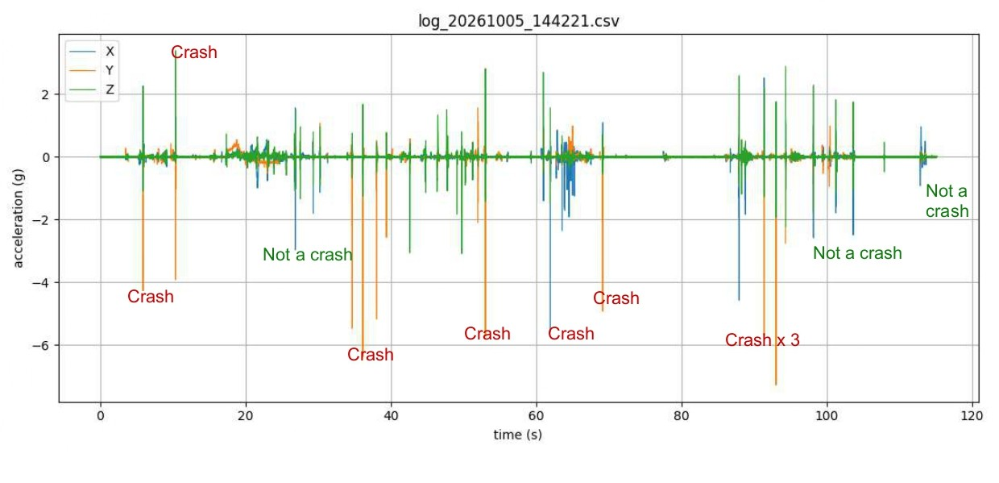

# FPGA Crash Detection Module

## About the project

This project is a crash detector built in VHDL for the **Digilent Nexys A7-100T** FPGA board. The idea is to imitate, on a small scale, what the control unit of a car airbag does: continuously read an acceleration sensor, work out whether a sudden deceleration (a crash) has happened, and trigger an output when it does.Here the output is an LED, so nothing in this project controls a real airbag.

The design reads the accelerometer that is already on the board, so no extra hardware is needed. Everything is written from scratch in VHDL:the SPI communication, the sensor setup and the UART link to the PC.

A video showing how it works can be found at the following link: https://youtu.be/pj-C49iV3VE

## The sensor: ADXL362

The ADXL362 is a 3-axis digital accelerometer from Analog Devices, soldered on the Nexys A7. The main facts relevant here:

- It measures acceleration on three axes (X, Y, Z) and is read over **SPI**. It supports SPI mode 0, and this project clocks it at 1 MHz.
- It has selectable ranges of 2 g, 4 g and 8 g, and output rates from 12.5 Hz up to 400 Hz. This design uses **8 g and 400 Hz**, so a short, strong impact still fits in the range.
- Each reading is a 12-bit signed number, delivered in two bytes per axis. At 8 g, one step (LSB) is 4 mg.
- At rest the sensor does not read zero. It measures the force that holds it against gravity, so a board lying flat reads about 1 g on the vertical axis. A crash shows up as a short, strong change on top of that, so the resting values will have to be subtracted before a crash can be detected.
- It can raise a **data-ready** signal on its INT1 pin each time a new sample is available. The design uses it to read exactly one sample per measurement.
- After power-up it is in standby, so it has to be configured and switched to measurement mode with register writes.

## The design files

Data flows through the modules in this order:

```
ADXL362 <-SPI-> spi_master <-> adxl362_ctrl -> sample_streamer -> uart_tx -> PC
```

**`spi_master.vhd`** is the lowest layer. It sends and receives one byte over SPI (mode 0, MSB first) and drives the SCLK and MOSI lines while sampling MISO. It knows nothing about the sensor: it gets a byte and a `start` pulse, and reports the received byte with a `done` pulse. Chip select is handled by the controller above it.

**`adxl362_ctrl.vhd`** knows the sensor's language. It uses the SPI master to check the sensor ID, configure the sensor, and then read the X, Y and Z values every time the sensor signals that new data is ready. It outputs the three readings as signed 16-bit numbers with a `sample_valid` pulse, and an `id_ok` flag. Its structure is explained in the next section.

**`sample_streamer.vhd`** packs each sample into a 7-byte frame (`0xAA`, then X, Y and Z as 16-bit values, high byte first) and hands the bytes to the UART one by one. The header byte lets the PC find the start of a frame, even if some bytes were lost.

**`uart_tx.vhd`** is a UART transmitter (115200 baud, 8 data bits, no parity, 1 stop bit). It turns each byte into the serial bit sequence and sends it through the board's USB-UART bridge to the PC.

**`top.vhd`** is the top level. It connects all the modules, synchronizes the reset button, and drives three LEDs: LED0 shows the sensor ID was read correctly, LED1 toggles with every new sample (at 400 Hz it simply looks lit), and LED2 shows that the data-ready signal from the sensor was seen. The CPU reset button restarts the whole sequence.

## How the sensor controller works: phases and states

`adxl362_ctrl.vhd` is organised on two levels.

A **phase** says *which SPI transaction* is being carried out. The controller goes through the phases in order, and then stays in the last one:

| Phase | Bytes sent | Purpose |
|---|---|---|
| `P_ID` | `0B 00` + 3 reads | read the three ID registers, expecting `AD`, `1D`, `F2` |
| `P_FILT` | `0A 2C 85` | write `FILTER_CTL`: 8 g range, 400 Hz output rate |
| `P_INT` | `0A 2A 01` | write `INTMAP1`: data-ready signal on INT1 |
| `P_PWR` | `0A 2D 02` | write `POWER_CTL`: switch to measurement mode |
| `P_SAMPLE` | `0B 0E` + 6 reads | read X, Y and Z (registers `0x0E` to `0x13`), repeatedly |

`0x0A` is the sensor's write command and `0x0B` is the read command. After the command comes the register address, and then the data.

A **state** says *which step of a transaction* the controller is in. The same six states run for every phase:

| State | What it does |
|---|---|
| `S_POWERUP` | waits about 20 ms after reset before talking to the sensor |
| `S_CS_LOW` | pulls chip select low to start a transaction |
| `S_SEND` | loads the next byte and tells the SPI master to send it |
| `S_WAIT` | waits for the byte to finish, stores the received byte, then goes back to `S_SEND` or ends the transaction |
| `S_CS_HIGH` | releases chip select, finishes the transaction and moves on to the next phase |
| `S_GAP` | waits before the next transaction. In the sampling phase it waits for the sensor's data-ready signal, with a 10 ms timeout as a fallback |

## Python script

**`live_plot.py`** lets you read and watch the live sensor data on your PC. It receives the frames from the board over the serial port and plots X, Y and Z in a scrolling window. Pressing `z` in the plot window subtracts the current resting values, so you can see only the movement, and closing the window saves everything to a CSV file.

To use it:

1. Program the board, then close any other program that uses the serial port (for example PuTTY).
2. Install the dependencies: `pip install pyserial matplotlib`
3. Open `live_plot.py` and set `PORT` to the COM port of the board (visible in Device Manager).
4. Run `python live_plot.py`.

## Live plot example

I will include a plot of all three axes (X, Y and Z) overlapped, taken with `live_plot.py`. The moments where the board was crashed will be marked on the screenshot.





## Building the project

1. In Vivado, create a project for the part `xc7a100tcsg324-1` (the Nexys A7-100T), add the VHDL files and set `top` as the top module.
2. Add a constraints (`.xdc`) file with the pin assignments for the clock, the reset button, the accelerometer (including INT1), the UART and the LEDs. Digilent publishes a master XDC for the board.
3. Generate the bitstream and program the board.
